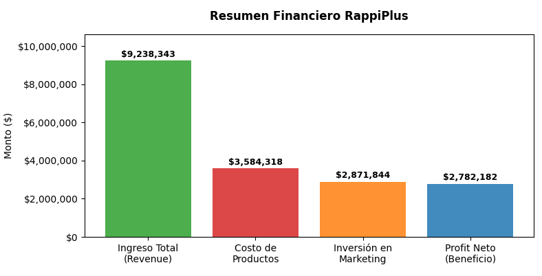
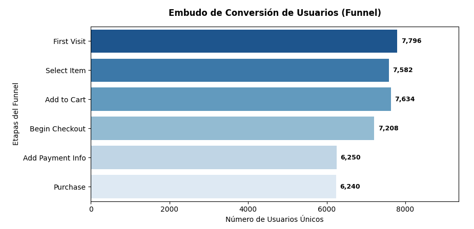
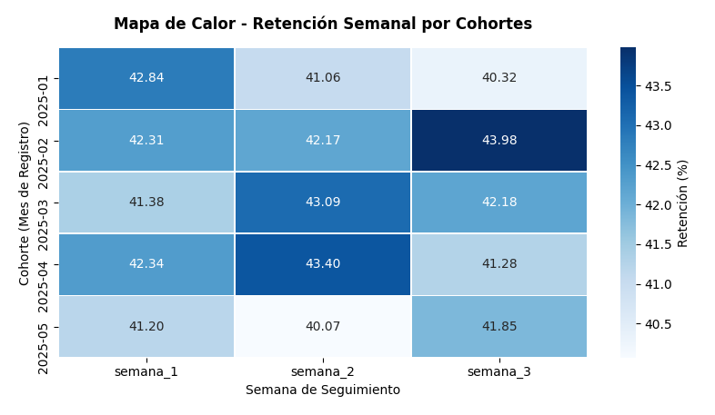

# 🚀 Diagnóstico Estratégico Integral: RappiPlus

> **Autora:** Florencia Amigo Martínez  
> **Enfoque Principal:** Optimización de la retención de clientes, análisis financiero y validación de impacto mediante experimentación.

---

## 📑 Índice
1. [Resumen Ejecutivo & Hallazgos Principales](#1-resumen-ejecutivo--hallazgos-principales)
2. [Introducción y Contexto del Negocio](#2-introducción-y-contexto-del-negocio)
3. [Paso 1: Preparación y Calidad de Datos](#3-paso-1-preparación-y-calidad-de-datos)
4. [Paso 2: Rentabilidad y Comportamiento de Ventas](#4-paso-2-rentabilidad-y-comportamiento-de-ventas)
5. [Paso 3: Análisis del Embudo de Conversión (Funnel)](#5-paso-3-análisis-del-embudo-de-conversión-funnel)
6. [Paso 4: Análisis de Retención por Cohortes (Foco Principal)](#6-paso-4-análisis-de-retención-por-cohortes-foco-principal)
7. [Paso 5: Evaluación de Impacto (Test A/B de Checkout)](#7-paso-5-evaluación-de-impacto-test-ab-de-checkout)
8. [Recomendaciones Estratégicas](#8-recomendaciones-estratégicas)
9. [Estructura del Repositorio](#9-estructura-del-repositorio)

---

## 1. Resumen Ejecutivo & Hallazgos Principales

A lo largo de este análisis, se evaluó el desempeño integral del servicio de suscripción **RappiPlus** dentro del ecosistema de Rappi. El núcleo del estudio se centró en auditar la salud financiera, rastrear las fricciones del usuario en el embudo, medir con precisión la retención y validar experimentalmente cambios en la interfaz.

### 💡 Hallazgos Clave
* **Rentabilidad Saludable:** El negocio genera un beneficio neto positivo de **$2,782,181.64**, superando ampliamente los costos operativos e inversión en marketing[cite: 3].
* **Retención Temprana Sólida (Foco del Proyecto):** La plataforma cuenta con un excelente nivel de *engagement* temprano. El análisis de cohortes demuestra que la retención semanal se mantiene estable entre el **40% y el 44%** hasta la semana 3, sin indicios de desgaste acelerado[cite: 6].
* **Fricción Crítica en Pagos:** El embudo de conversión muestra una caída abrupta hacia la etapa de `Add_payment_info`, siendo el principal cuello de botella operativo[cite: 5].
* **Experimento de UI No Concluyente:** El test A/B aplicado al nuevo diseño del checkout no arrojó diferencias estadísticamente significativas ($p = 0.416$), por lo que se recomienda evaluar el esfuerzo técnico antes de implementarlo masivamente.

---

## 2. Introducción y Contexto del Negocio

**RappiPlus** es un servicio de suscripción diseñado para potenciar la frecuencia de compra y el valor por usuario dentro de la plataforma. Para medir su éxito, se analizaron tres fuentes de datos principales: registros de pedidos, catálogos de productos e inversión en marketing, complementadas con datos de eventos de comportamiento y cohortes de actividad de usuarios.

---

## 3. Paso 1: Preparación y Calidad de Datos

Antes de ejecutar modelos o cálculos, se auditó la calidad de los datos crudos (`rappiplus_orders_raw.csv`, `rappiplus_catalog.csv` y `rappiplus_marketing_spend.csv`), estandarizando tipos de datos, corrigiendo nulos y unificando criterios de fechas y categorías para garantizar una base sólida y confiable.

---

## 4. Paso 2: Rentabilidad y Comportamiento de Ventas

Se evaluaron los indicadores financieros globales de la plataforma:
* **Ingreso Total (Revenue):** \$9,238,342.80[cite: 3]
* **Costo Total de Productos:** \$3,584,317.63[cite: 3]
* **Inversión en Marketing:** \$2,871,843.53[cite: 3]
* **Beneficio Neto (Profit):** \$2,782,181.64[cite: 3]



* **Comportamiento Comercial:** El ticket promedio se ubica en **\$388.26** con un promedio de **1.48 productos** por orden. El producto con mayor volumen comercial fue el `Vacuum-Pro-Black` (5,952 unidades). No obstante, se detectaron anomalías puntuales en productos específicos (como `Laptop-Gaming-16GB`) que registraron márgenes negativos y requieren revisión de proveedores.

---

## 5. Paso 3: Análisis del Embudo de Conversión (Funnel)

El análisis del recorrido del usuario a través de la tabla de eventos reveló el comportamiento del tráfico:



* **Volumen General:** Se parte de una base de 7,796 visitantes únicos (`First Visit`), logrando guiar a 6,240 compradores finales hacia el éxito de la transacción (`Purchase`)[cite: 5].
* **Anomalía en `Add to Cart` (>100%):** Este fenómeno responde a campañas de atracción mediante *deep links*, donde usuarios ingresan directamente a fichas de producto específicas sin pasar por la página principal en esa misma sesión.
* **Cuello de Botella:** La pérdida más significativa de usuarios ocurre en la transición hacia `Add_payment_info`, señalando fricciones directas en la pasarela de pagos[cite: 5].

---

## 6. Paso 4: Análisis de Retención por Cohortes (Foco Principal)

Para entender el comportamiento temporal de los usuarios registrados, se estructuraron cohortes mensuales y se evaluó su actividad semanal (`user_activity`):



* **Estabilidad Consistente:** A través del mapa de calor, se observa que la tasa de retención se mantiene sumamente estable entre las diferentes cohortes mensuales, oscilando de manera consistente **entre el 40% y el 44%** desde la semana 1 hasta la semana 3[cite: 6].
* **Fidelización Temprana:** Los datos confirman que los usuarios que se registran en RappiPlus mantienen su actividad de forma sostenida durante las primeras tres semanas de vida en la aplicación, evidenciando un *engagement* inicial muy saludable que amortigua el abandono prematuro[cite: 6].

---

## 7. Paso 5: Evaluación de Impacto (Test A/B de Checkout)

Se evaluó el impacto de un cambio en la interfaz de usuario (UI) del checkout utilizando un **Test Z de 2 proporciones** ($\alpha = 0.05$):
* **Hipótesis Nula ($H_0$):** La conversión del grupo de control es igual a la del grupo de tratamiento.
* **Resultado:** Se obtuvo un **p-valor de 0.416**, muy superior al nivel de significancia del 5%. Esto indica que las diferencias observadas no son estadísticamente concluyentes; el nuevo diseño no alteró de forma relevante la conversión final.

---

## 8. Recomendaciones Estratégicas

1. **Optimización de Pasarela de Pagos:** Reducir la fricción en el paso `Add_payment_info` simplificando formularios y ofreciendo métodos de pago alternativos; representa la oportunidad de mayor impacto inmediato en ventas.
2. **Aprovechar la Alta Retención Temprana:** Dado que el ~42% de los usuarios se retiene de forma estable hasta la semana 3[cite: 6], se recomienda diseñar campañas de fidelización y notificaciones personalizadas justo antes de la semana 4 para consolidar la lealtad a largo plazo.
3. **Auditoría de Costos de Proveedores:** Revisar la estructura de costos de artículos específicos con márgenes negativos para blindar la rentabilidad neta general de la plataforma.
4. **Pausar Despliegue Masivo de UI:** Al no mostrar impactos significativos en el test A/B, se aconseja reevaluar los costos de ingeniería del rediseño del checkout antes de destinar más recursos técnicos.

---

## 9. Estructura del Repositorio
```text
├── images/                    # Visualizaciones y gráficos del análisis
├── notebook/                  # Jupyter Notebook con el análisis completo (Colab)
└── README.md                  # Documentación del proyecto
